# bo2jodas: arquetipos, cartas y números

Generado por `tools/generar_diagramas.py` a partir de los scripts del mod (valores de las cartas y configuración por defecto) y de los archivos de arma del juego. Los diagramas se ven en GitHub o con una extensión de Mermaid.

Todas las cartas normales se **acumulan**: cada vez que coges una, su valor se suma hasta el tope. Los valores son por rareza: común / poco común / rara / épica / legendaria.

## Vida de los zombies por ronda

Fórmula del juego con los valores del mod: ronda 1 = 188; cada ronda hasta la 9 suma 130; desde la 10 se multiplica por 1.13 (truncando). Tanque = ×4 la vida del zombie de su ronda. Jefes: Brutus ×70, Bruja ×40, Leroy ×50; ningún golpe les quita más del 15 % de su vida.

| Ronda | Zombie (mod) | Zombie (de serie) | Tanque | Brutus | Bruja | Leroy | Tope por golpe al jefe |
|---|---|---|---|---|---|---|---|
| 1 | 188 | 150 | 752 | 13160 | 7520 | 9400 | 1974 |
| 5 | 708 | 550 | 2832 | 49560 | 28320 | 35400 | 7434 |
| 10 | 1387 | 1045 | 5548 | 97090 | 55480 | 69350 | 14563 |
| 20 | 4699 | 2701 | 18796 | 328930 | 187960 | 234950 | 49339 |
| 30 | 15943 | 7000 | 63772 | 1116010 | 637720 | 797150 | 167401 |
| 40 | 54111 | 18151 | 216444 | 3787770 | 2164440 | 2705550 | 568165 |
| 50 | 183674 | 47073 | 734696 | 12857180 | 7346960 | 9183700 | 1928577 |

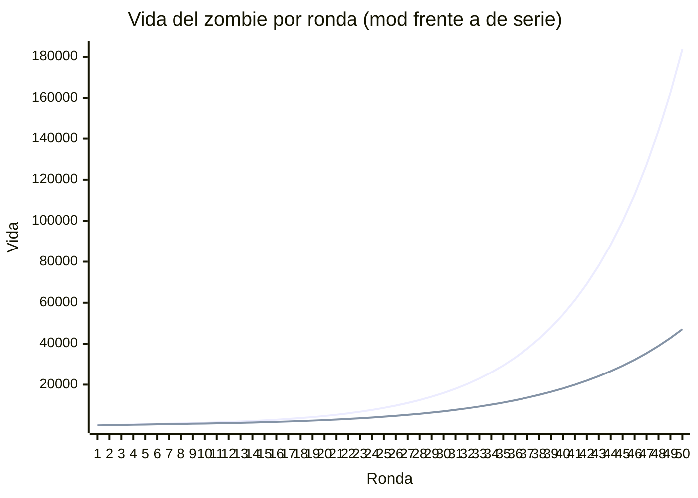

## Cómo se construye una build

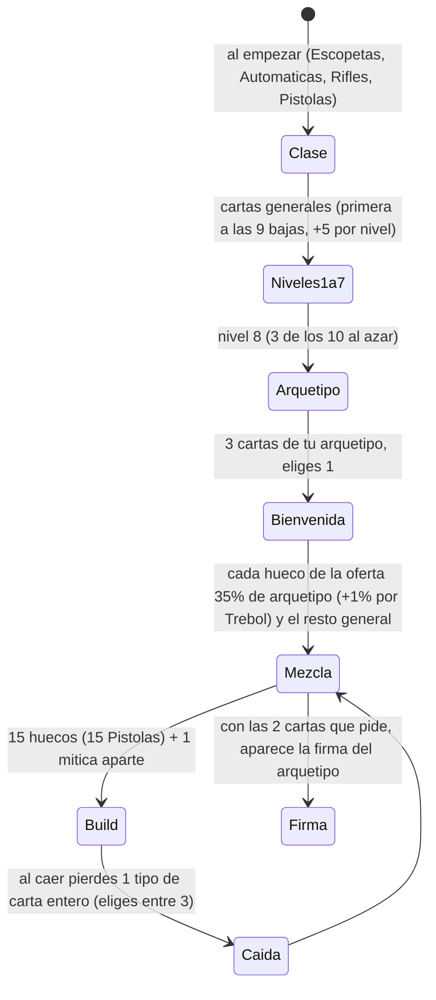

Rarezas: común 50 %, poco común 28 %, rara 14 %, épica 6 %, legendaria 2 %; Trébol y Pulsera suben escalones. Mítica: 5 % de que una carta de la oferta sea mítica (una por jugador, no ocupa hueco).

## Cómo se calcula el daño de un disparo

Tal cual lo hace `jodas_danio_saliente` + `jodas_arq_mult_saliente`. Todos los porcentajes de cartas **se suman** en un único multiplicador; sólo después se aplican los factores (×3, Cuerpo de cristal, crítico).

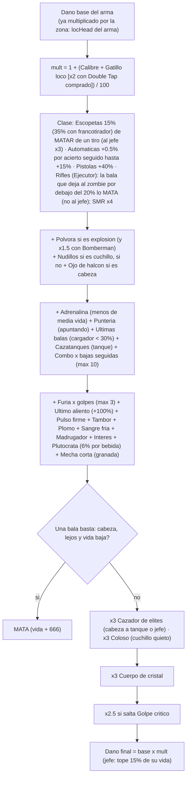

Los rayos (Electricista), el fuego, Espinas, Ciclón, los mordiscos de leaper, la Reacción en cadena, Zeus, Fénix y Electric Cherry parten de un % de la vida del zombie (o de un daño fijo) y **también** pasan por esta fórmula: Calibre, Gatillo loco, Adrenalina, Cuerpo de cristal y demás los multiplican. Las cartas que piden bala, cabeza o cuchillo no cuentan en ellos.

## Los 10 arquetipos de un vistazo

Cada arquetipo tiene 6 cartas; la **firma** sólo aparece cuando tienes las dos que pide (flechas `requiere`). Las que ya existían antes de la 1.8 van marcadas con *.

```mermaid
flowchart LR
    subgraph piromano["Piromano: Fuego que se contagia y explosivos"]
        explosivo["Polvora*<br/>+8% / +12.8% / +17.6% / +24% / +32%"]
        fosforo["Fosforo<br/>2% / 3.2% / 4.4% / 6% / 8%"]
        napalm["Napalm<br/>2.5% / 4% / 5.5% / 7.5% / 10%"]
        rescoldos["Rescoldos<br/>+1.5 / +2.4 / +3.3 / +4.5 / +6"]
        mecha["Mecha corta<br/>+7.5% / +12% / +16.5% / +22.5% / +30%"]
        pirotecnico["Pirotecnico (firma)<br/>FIRMA (una vez)"]
    end
    subgraph electricista["Electricista: Rayos que saltan de zombie en zombie"]
        cadena["Reaccion en cadena*<br/>1.5% / 2.4% / 3.3% / 4.5% / 6%"]
        pararrayos["Pararrayos<br/>2% / 3.2% / 4.4% / 6% / 8%"]
        sobrecarga["Sobrecarga<br/>5% / 8% / 11% / 15% / 20%"]
        condensador["Condensador<br/>7.5% / 12% / 16.5% / 22.5% / 30%"]
        tormenta["Tormenta<br/>2.25% / 3.6% / 4.95% / 6.75% / 9%"]
        tesla["Tesla (firma)<br/>FIRMA (una vez)"]
    end
    subgraph berserker["Berserker: Cuanto mas herido, mas peligroso"]
        vampiro["Vampiro*<br/>+1.5 / +2.4 / +3.3 / +4.5 / +6"]
        adrenalina["Adrenalina*<br/>+5% / +8% / +11% / +15% / +20%"]
        furia["Furia<br/>+1.5% / +2.4% / +3.3% / +4.5% / +6%"]
        sangre["Sangre caliente<br/>+1 / +1.6 / +2.2 / +3 / +4"]
        ultimo["Ultimo aliento<br/>0.3 s / 0.48 s / 0.66 s / 0.9 s / 1.2 s"]
        imparable["Imparable (firma)<br/>FIRMA (una vez)"]
    end
    subgraph francotirador["Francotirador: Tiros a la cabeza lentos y letales"]
        cabeza["Ojo de halcon*<br/>+8% / +12.8% / +17.6% / +24% / +32%"]
        punteria["Punteria*<br/>+2.5% / +4% / +5.5% / +7.5% / +10%"]
        cazatanques["Cazatanques*<br/>+10% / +16% / +22% / +30% / +40%"]
        pulso["Pulso firme<br/>+5% / +8% / +11% / +15% / +20%"]
        unabala["Una bala basta<br/>1.5% / 2.4% / 3.3% / 4.5% / 6%"]
        elites["Cazador de elites (firma)<br/>FIRMA (una vez)"]
    end
    subgraph tanque["Tanque: x2 vida con Jugg y escudo nuevo cada ronda"]
        melee["Nudillos de hierro*<br/>+40% / +64% / +88% / +120% / +160%"]
        espinas["Espinas*<br/>12.5% / 20% / 27.5% / 37.5% / 50%"]
        piedra["Piel de piedra<br/>-1.5% / -2.4% / -3.3% / -4.5% / -6%"]
        coraza["Coraza<br/>-1.5 / -2.4 / -3.3 / -4.5 / -6"]
        masa["Masa<br/>+1.5 / +2.4 / +3.3 / +4.5 / +6"]
        coloso["Coloso (firma)<br/>FIRMA (una vez)"]
    end
    subgraph banquero["Banquero: Los puntos son poder"]
        puntos["Codicia*<br/>+5 / +8 / +11 / +15 / +20"]
        oro["Cabezas de oro*<br/>+8 / +12.8 / +17.6 / +24 / +32"]
        interes["Interes compuesto<br/>1.25% / 2% / 2.75% / 3.75% / 5%"]
        mercenario["Mercenario<br/>+50 / +80 / +110 / +150 / +200"]
        cajaeco["Caja economica<br/>-1.5% / -2.4% / -3.3% / -4.5% / -6%"]
        plutocrata["Plutocrata (firma)<br/>FIRMA (una vez)"]
    end
    subgraph gatillo["Gatillo: Disparar sin parar y sin recargar"]
        cadencia["Gatillo loco*<br/>+2.5% / +4% / +5.5% / +7.5% / +10%"]
        ultimas["Ultimas balas*<br/>+5% / +8% / +11% / +15% / +20%"]
        tambor["Tambor caliente<br/>+3.75% / +6% / +8.25% / +11.25% / +15%"]
        plomo["Plomo<br/>2.5% / 4% / 5.5% / 7.5% / 10%"]
        cinta["Cinta de balas<br/>+0.5 / +0.8 / +1.1 / +1.5 / +2"]
        continuo["Fuego continuo (firma)<br/>FIRMA (una vez)"]
    end
    subgraph velocista["Velocista: Correr, esquivar y no parar"]
        escurridizo["Escurridizo*<br/>0.88% / 1.4% / 1.93% / 2.62% / 3.5%"]
        sed["Sed de sangre*<br/>+1.5% / +2.4% / +3.3% / +4.5% / +6%"]
        resbaladizo["Esquiva<br/>0.88% / 1.4% / 1.93% / 2.62% / 3.5%"]
        zancada["Zancada<br/>+2.5% / +4% / +5.5% / +7.5% / +10%"]
        estela["Estela<br/>0.75% / 1.2% / 1.65% / 2.25% / 3%"]
        ciclon["Ciclon (firma)<br/>FIRMA (una vez)"]
    end
    subgraph domador["Domador: Leapers que luchan por ti"]
        silbato["Silbato<br/>1 / 1 / 1 / 1 / 1"]
        correa["Correa larga<br/>+2.5% / +4% / +5.5% / +7.5% / +10%"]
        collar["Collar de puas<br/>+5% / +8% / +11% / +15% / +20%"]
        carne["Carne fresca<br/>+1.25 / +2 / +2.75 / +3.75 / +5"]
        manada["Manada<br/>+2.5% / +4% / +5.5% / +7.5% / +10%"]
        alfa["Alfa (firma)<br/>FIRMA (una vez)"]
    end
    subgraph mecanico["Mecanico: Torretas que disparan por ti"]
        herramientas["Caja de herramientas<br/>1 / 1 / 1 / 1 / 1"]
        engranajes["Engranajes<br/>+2.5% / +4% / +5.5% / +7.5% / +10%"]
        recargatorreta["Recarga rapida<br/>-1.75% / -2.8% / -3.85% / -5.25% / -7%"]
        calibre50["Calibre .50<br/>+5% / +8% / +11% / +15% / +20%"]
        rebote["Rebote<br/>2% / 3.2% / 4.4% / 6% / 8%"]
        montaje["Cadena de montaje<br/>+2.5% / +4% / +5.5% / +7.5% / +10%"]
        mortero["Mortero (firma)<br/>FIRMA (una vez)"]
    end
    subgraph suertudo["Suertudo: Rerolls, dados y cartas mejores"]
        botin["Buscador de botin*<br/>0.1% / 0.16% / 0.22% / 0.3% / 0.4%"]
        conejo["Pata de conejo<br/>+0.5 / +0.8 / +1.1 / +1.5 / +2"]
        dados["Dados<br/>2% / 3.2% / 4.4% / 6% / 8%"]
        amuleto["Amuleto<br/>2.5% / 4% / 5.5% / 7.5% / 10%"]
        herradura["Herradura<br/>2.5% / 4% / 5.5% / 7.5% / 10%"]
        jackpot["Jackpot (firma)<br/>FIRMA (una vez)"]
    end
    fosforo -->|requiere| pirotecnico
    explosivo -->|requiere| pirotecnico
    pararrayos -->|requiere| tesla
    condensador -->|requiere| tesla
    adrenalina -->|requiere| imparable
    furia -->|requiere| imparable
    cabeza -->|requiere| elites
    pulso -->|requiere| elites
    espinas -->|requiere| coloso
    piedra -->|requiere| coloso
    puntos -->|requiere| plutocrata
    interes -->|requiere| plutocrata
    tambor -->|requiere| continuo
    plomo -->|requiere| continuo
    sed -->|requiere| ciclon
    estela -->|requiere| ciclon
    silbato -->|requiere| correa
    silbato -->|requiere| collar
    silbato -->|requiere| carne
    silbato -->|requiere| manada
    collar -->|requiere| alfa
    manada -->|requiere| alfa
    herramientas -->|requiere| engranajes
    herramientas -->|requiere| recargatorreta
    herramientas -->|requiere| calibre50
    herramientas -->|requiere| rebote
    herramientas -->|requiere| montaje
    calibre50 -->|requiere| mortero
    montaje -->|requiere| mortero
    dados -->|requiere| jackpot
    conejo -->|requiere| jackpot
```

## Cada arquetipo en detalle

### Piromano: Fuego que se contagia y explosivos

| Carta | Efecto | Valores | Tope | Rareza |
|---|---|---|---|---|
| Polvora | Potencia de los explosivos | +8% / +12.8% / +17.6% / +24% / +32% | +320% | variable |
| Fosforo | Probabilidad de que tus balas incendien | 2% / 3.2% / 4.4% / 6% / 8% | 80% | variable |
| Napalm | Un zombie ardiendo contagia: % por s | 2.5% / 4% / 5.5% / 7.5% / 10% | 100% | variable |
| Rescoldos | Vida al matar a un zombie ardiendo | +1.5 / +2.4 / +3.3 / +4.5 / +6 | +60 | variable |
| Mecha corta | Granadas: estallan al caer y hacen +% | +7.5% / +12% / +16.5% / +22.5% / +30% | +300% | variable |
| **Pirotecnico** | FIRMA: tus explosiones incendian a todos | FIRMA (una vez) | — | Epica |

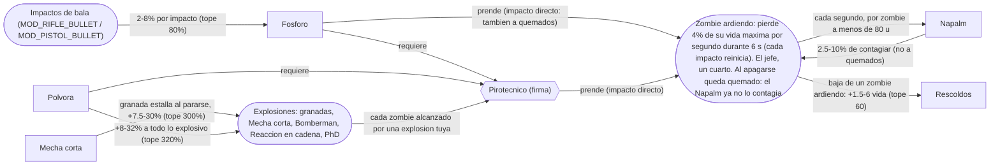

### Electricista: Rayos que saltan de zombie en zombie

| Carta | Efecto | Valores | Tope | Rareza |
|---|---|---|---|---|
| Reaccion en cadena | Probabilidad de que el zombie explote | 1.5% / 2.4% / 3.3% / 4.5% / 6% | 60% | variable |
| Pararrayos | % de rayo al matar: 15% vida a otro | 2% / 3.2% / 4.4% / 6% / 8% | 80% | variable |
| Sobrecarga | Al recargar, rayo al mas cercano: % vida | 5% / 8% / 11% / 15% / 20% | 200% | variable |
| Condensador | 10 bajas sin dano: 3 rayos de % vida | 7.5% / 12% / 16.5% / 22.5% / 30% | 300% | variable |
| Tormenta | Descarga alrededor: % vida, y mas seguido | 2.25% / 3.6% / 4.95% / 6.75% / 9% | 90% | variable |
| **Tesla** | FIRMA: todos tus rayos alcanzan a 2 mas | FIRMA (una vez) | — | Epica |

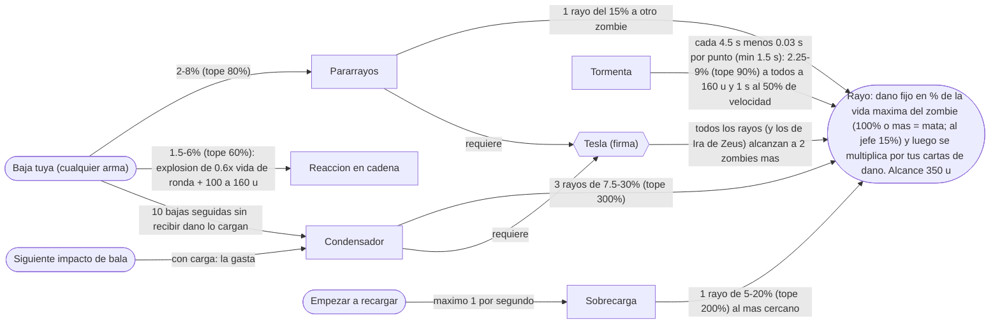

### Berserker: Cuanto mas herido, mas peligroso

| Carta | Efecto | Valores | Tope | Rareza |
|---|---|---|---|---|
| Vampiro | Vida por baja | +1.5 / +2.4 / +3.3 / +4.5 / +6 | +60 | variable |
| Adrenalina | +% potencia con menos de media vida | +5% / +8% / +11% / +15% / +20% | +200% | variable |
| Furia | +% potencia 5 s por golpe recibido (x3) | +1.5% / +2.4% / +3.3% / +4.5% / +6% | +60% | variable |
| Sangre caliente | Vida por segundo con menos de media vida | +1 / +1.6 / +2.2 / +3 / +4 | +40 | variable |
| Ultimo aliento | Bajo 25% vida: s de invulnerable, 1/ronda | 0.3 s / 0.48 s / 0.66 s / 0.9 s / 1.2 s | 12 s | variable |
| **Imparable** | FIRMA: bajo 25% vida +20% vel, golpes -50% | FIRMA (una vez) | — | Epica |

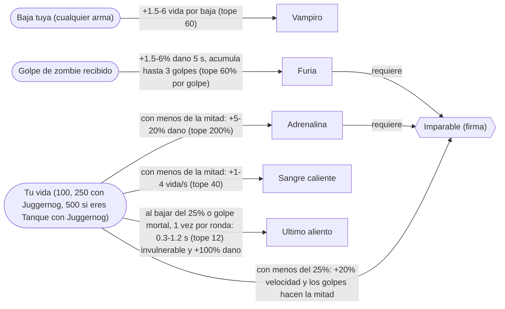

### Francotirador: Tiros a la cabeza lentos y letales

| Carta | Efecto | Valores | Tope | Rareza |
|---|---|---|---|---|
| Ojo de halcon | Potencia en tiros a la cabeza | +8% / +12.8% / +17.6% / +24% / +32% | +320% | variable |
| Punteria | +% potencia apuntando con la mira | +2.5% / +4% / +5.5% / +7.5% / +10% | +100% | variable |
| Cazatanques | +% potencia contra tanques | +10% / +16% / +22% / +30% / +40% | +400% | variable |
| Pulso firme | +% potencia tras 2 s sin disparar | +5% / +8% / +11% / +15% / +20% | +200% | variable |
| Una bala basta | Cabeza lejos mata si al zombie le queda <% | 1.5% / 2.4% / 3.3% / 4.5% / 6% | 60% | variable |
| **Cazador de elites** | FIRMA: cabeza a tanque o jefe hace x3 | FIRMA (una vez) | — | Epica |

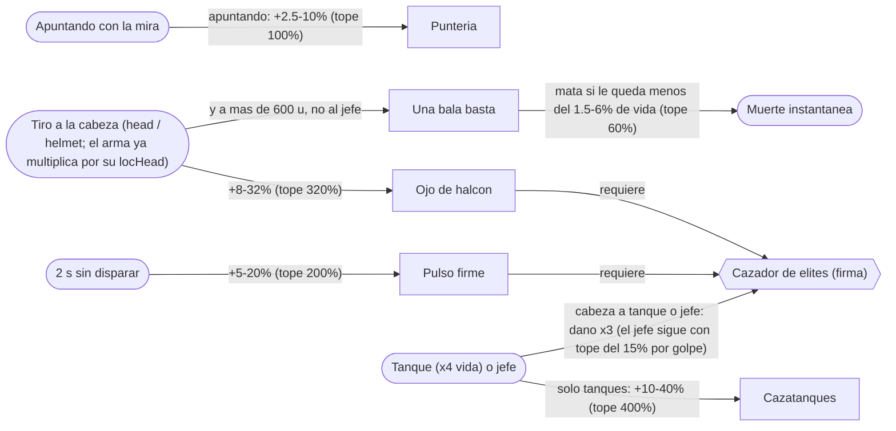

### Tanque: x2 vida con Jugg y escudo nuevo cada ronda

| Carta | Efecto | Valores | Tope | Rareza |
|---|---|---|---|---|
| Nudillos de hierro | Potencia cuerpo a cuerpo | +40% / +64% / +88% / +120% / +160% | +1600% | variable |
| Espinas | Quien te golpea pierde % de su vida | 12.5% / 20% / 27.5% / 37.5% / 50% | 500% | variable |
| Piel de piedra | -% dano recibido estando quieto | -1.5% / -2.4% / -3.3% / -4.5% / -6% | -60% | variable |
| Coraza | Cada golpe de zombie hace esto menos | -1.5 / -2.4 / -3.3 / -4.5 / -6 | -60 | variable |
| Masa | +vida maxima por cada carta de Tanque | +1.5 / +2.4 / +3.3 / +4.5 / +6 | +60 | variable |
| **Coloso** | FIRMA: quieto reflejas todo; cuchillo x3 | FIRMA (una vez) | — | Epica |

### Banquero: Los puntos son poder

| Carta | Efecto | Valores | Tope | Rareza |
|---|---|---|---|---|
| Codicia | Puntos extra por baja | +5 / +8 / +11 / +15 / +20 | +200 | variable |
| Cabezas de oro | Puntos extra por baja a la cabeza | +8 / +12.8 / +17.6 / +24 / +32 | +320 | variable |
| Interes compuesto | +1% potencia por cada 1000 puntos (tope %) | 1.25% / 2% / 2.75% / 3.75% / 5% | 50% | variable |
| Mercenario | Cada 50 bajas tuyas +puntos a todos | +50 / +80 / +110 / +150 / +200 | +2000 | variable |
| Caja economica | La caja te cuesta menos | -1.5% / -2.4% / -3.3% / -4.5% / -6% | -60% | variable |
| **Plutocrata** | FIRMA: +6% potencia por perk, +50 puntos | FIRMA (una vez) | — | Epica |

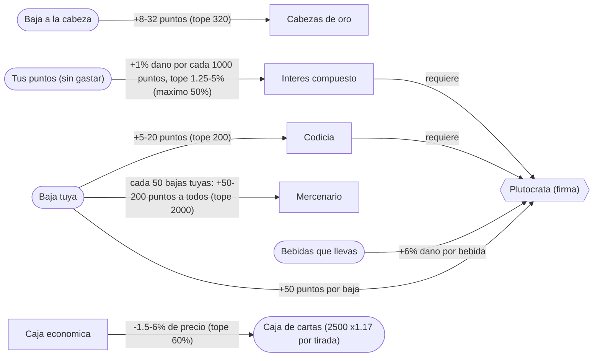

### Gatillo: Disparar sin parar y sin recargar

| Carta | Efecto | Valores | Tope | Rareza |
|---|---|---|---|---|
| Gatillo loco | Double Tap gratis y mas potencia | +2.5% / +4% / +5.5% / +7.5% / +10% | +100% | variable |
| Ultimas balas | +% potencia con el cargador casi vacio | +5% / +8% / +11% / +15% / +20% | +200% | variable |
| Tambor caliente | +% potencia tras 1 s disparando seguido | +3.75% / +6% / +8.25% / +11.25% / +15% | +150% | variable |
| Plomo | +1% potencia por bala seguida (tope %) | 2.5% / 4% / 5.5% / 7.5% / 10% | 100% | variable |
| Cinta de balas | Balas al cargador por baja | +0.5 / +0.8 / +1.1 / +1.5 / +2 | +20 | variable |
| **Fuego continuo** | FIRMA: con combo 10 el cargador no baja | FIRMA (una vez) | — | Epica |

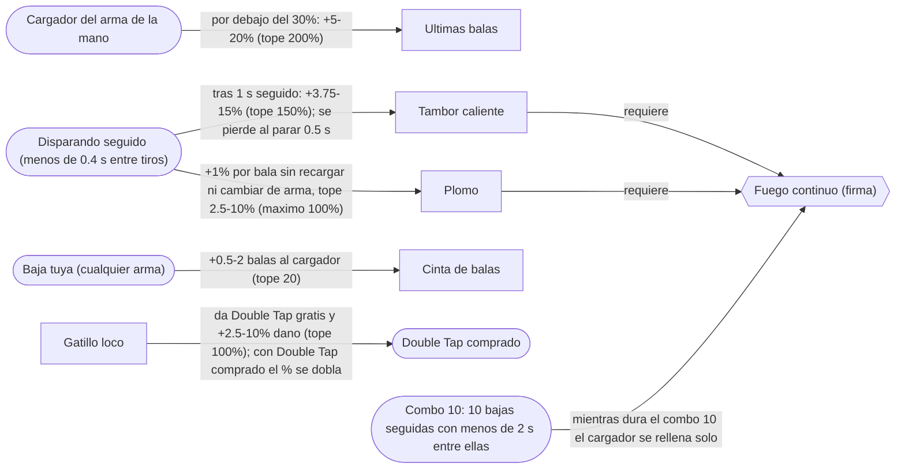

### Velocista: Correr, esquivar y no parar

| Carta | Efecto | Valores | Tope | Rareza |
|---|---|---|---|---|
| Escurridizo | % de que te ignoren 2 s tras un golpe | 0.88% / 1.4% / 1.93% / 2.62% / 3.5% | 35% | variable |
| Sed de sangre | +% velocidad 3 s tras cada baja | +1.5% / +2.4% / +3.3% / +4.5% / +6% | +60% | variable |
| Esquiva | % de esquivar golpes en movimiento | 0.88% / 1.4% / 1.93% / 2.62% / 3.5% | 35% | variable |
| Zancada | Stamin-Up gratis y +% dano 2 s tras correr | +2.5% / +4% / +5.5% / +7.5% / +10% | +100% | variable |
| Estela | Rastro de fuego: % vida por segundo | 0.75% / 1.2% / 1.65% / 2.25% / 3% | 30% | variable |
| **Ciclon** | FIRMA: esprintando danas a tu alrededor | FIRMA (una vez) | — | Epica |

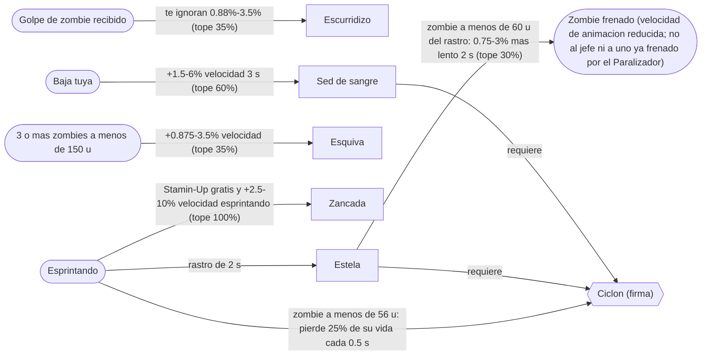

### Domador: Leapers que luchan por ti

| Carta | Efecto | Valores | Tope | Rareza |
|---|---|---|---|---|
| Silbato | Un leaper cachorro te sigue y muerde | 1 / 1 / 1 / 1 / 1 | 1 | Rara |
| Correa larga | Tus leapers van +% mas rapido | +2.5% / +4% / +5.5% / +7.5% / +10% | +100% | variable |
| Collar de puas | Mordiscos de tus leapers +% | +5% / +8% / +11% / +15% / +20% | +200% | variable |
| Carne fresca | Vida por mordisco letal de tus leapers | +1.25 / +2 / +2.75 / +3.75 / +5 | +50 | variable |
| Manada | +% radio de caza; 2.o leaper a 5 copias, 3.o a 10 | +2.5% / +4% / +5.5% / +7.5% / +10% | +100% | variable |
| **Alfa** | FIRMA: al matar, tus leapers x2 e incendian | FIRMA (una vez) | — | Epica |

### Mecanico: Torretas que disparan por ti

| Carta | Efecto | Valores | Tope | Rareza |
|---|---|---|---|---|
| Caja de herramientas | Construyes una torreta automatica | 1 / 1 / 1 / 1 / 1 | 1 | Rara |
| Engranajes | Tus torretas disparan +% mas rapido | +2.5% / +4% / +5.5% / +7.5% / +10% | +100% | variable |
| Recarga rapida | Tus torretas recargan en -% de tiempo | -1.75% / -2.8% / -3.85% / -5.25% / -7% | -70% | variable |
| Calibre .50 | Balas de tus torretas +% dano | +5% / +8% / +11% / +15% / +20% | +200% | variable |
| Rebote | % de que la bala salte a otro zombie cercano | 2% / 3.2% / 4.4% / 6% / 8% | 80% | variable |
| Cadena de montaje | +% aguante; 2.a torreta a 5 copias, 3.a a 10 | +2.5% / +4% / +5.5% / +7.5% / +10% | +100% | variable |
| **Mortero** | FIRMA: cada 8 s tus torretas lanzan mortero | FIRMA (una vez) | — | Epica |

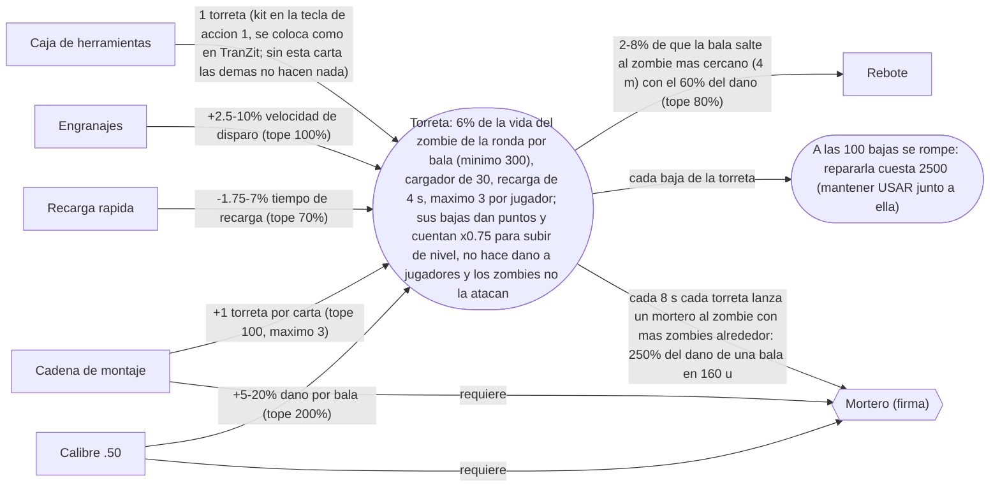

### Suertudo: Rerolls, dados y cartas mejores

| Carta | Efecto | Valores | Tope | Rareza |
|---|---|---|---|---|
| Buscador de botin | Probabilidad de power-up por baja | 0.1% / 0.16% / 0.22% / 0.3% / 0.4% | 4% | variable |
| Pata de conejo | +rerolls ahora y +1 cada 3 niveles | +0.5 / +0.8 / +1.1 / +1.5 / +2 | +20 | variable |
| Dados | % de que la carta que cojas valga el doble | 2% / 3.2% / 4.4% / 6% / 8% | 80% | variable |
| Amuleto | % de ver 4 cartas en vez de 3 | 2.5% / 4% / 5.5% / 7.5% / 10% | 100% | variable |
| Herradura | % de power-up a tus pies al empezar ronda | 2.5% / 4% / 5.5% / 7.5% / 10% | 100% | variable |
| **Jackpot** | FIRMA: 1 legendaria por ronda y rerolls al 50% | FIRMA (una vez) | — | Epica |

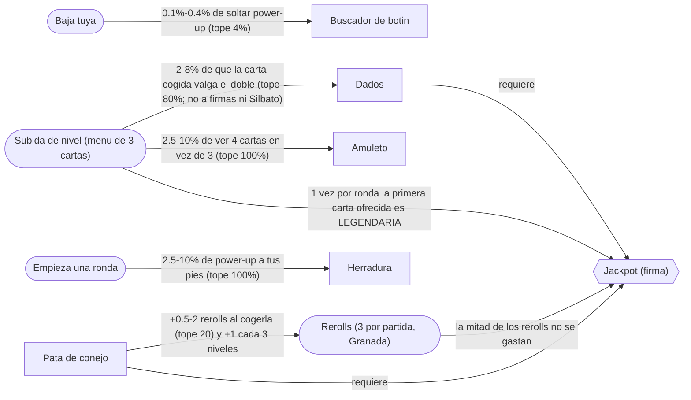

## Cartas generales (le salen a todos)

| Carta | Tipo | Efecto | Valores | Tope |
|---|---|---|---|---|
| Piernas ligeras | normal | Velocidad de movimiento | +2% / +3.2% / +4.4% / +6% / +8% | +80% |
| Muelles | normal | Saltas mas alto caer no te hiere | +17.5 / +28 / +38.5 / +52.5 / +70 | +700 |
| Calibre | normal | Mas potencia con todas las armas | +4% / +6.4% / +8.8% / +12% / +16% | +160% |
| Cargador magico | normal | Probabilidad de no gastar bala | 1.5% / 2.4% / 3.3% / 4.5% / 6% | 60% |
| Manos rapidas | normal | Speed Cola gratis y recarga al matar | 0.09% / 0.14% / 0.2% / 0.27% / 0.36% | 3.6% |
| Mochila | normal | Balas de reserva por minuto | +1.5 b/min / +2.4 b/min / +3.3 b/min / +4.5 b/min / +6 b/min | +60 b/min |
| Corazon de hierro | normal | Vida maxima | +8 / +12.8 / +17.6 / +24 / +32 | +320 |
| Regeneracion | normal | Vida por segundo | +0.62 / +1 / +1.38 / +1.88 / +2.5 | +25 |
| Blindaje | normal | Golpes de zombie hacen menos | -1.5% / -2.4% / -3.3% / -4.5% / -6% | -60% |
| Golpe critico | normal | Probabilidad de golpe x2.5 | 1.5% / 2.4% / 3.3% / 4.5% / 6% | 60% |
| Iman | normal | Atrae power-ups en este radio | 125 / 200 / 275 / 375 / 500 | 5000 |
| Segundo aliento | normal | Probabilidad de evitar caer | 2.25% / 3.6% / 4.95% / 6.75% / 9% | 90% |
| Suerte del Pack | normal | Arma de ronda mejorada | 2.5% / 4% / 5.5% / 7.5% / 10% | 100% |
| Granadero | normal | Recuperar granada al matar | 1.5% / 2.4% / 3.3% / 4.5% / 6% | 60% |
| Afortunado | normal | Arma especial de tu clase | +1.75% / +2.8% / +3.85% / +5.25% / +7% | +70% |
| Trebol | normal | Las cartas salen de mas rareza | 1.5% / 2.4% / 3.3% / 4.5% / 6% | 60% |
| Experiencia | normal | Cada baja cuenta +% para las cartas | +3.75% / +6% / +8.25% / +11.25% / +15% | +150% |
| Combo | normal | +% potencia por baja seguida (max 10) | +0.5% / +0.8% / +1.1% / +1.5% / +2% | +20% |
| Maldicion | normal | +% dificultad: mas zombies y mas premio | +2.5% / +4% / +5.5% / +7.5% / +10% | +100% |
| Monos | equipo | equipo cymbal_monkey_zm | +1/ronda / +1/ronda / +1/ronda / +1/ronda / +1/ronda | +1/ronda |
| Claymores | equipo | equipo claymore_zm | +1/ronda / +1/ronda / +1/ronda / +1/ronda / +1/ronda | +1/ronda |
| Semtex | equipo | equipo sticky_grenade_zm | +1/ronda / +1/ronda / +1/ronda / +1/ronda / +1/ronda | +1/ronda |
| Granadas EMP | equipo | equipo emp_grenade_zm | +1/ronda / +1/ronda / +1/ronda / +1/ronda / +1/ronda | +1/ronda |
| Pack-a-Punch | instantanea | Mejora el arma que llevas en la mano | 0 / 0 / 0 / 0 / 0 | 1 |
| Municion maxima | powerup | power-up full_ammo | — | — |
| Instakill | powerup | power-up insta_kill | — | — |
| Doble puntos | powerup | power-up double_points | — | — |
| Carpintero | powerup | power-up carpenter | — | — |
| Nuke | powerup | power-up nuke | — | — |
| Armadura | normal | Golpes que absorbes del todo cada ronda | +0.15 / +0.24 / +0.33 / +0.45 / +0.6 | +6 |
| Sangre fria | normal | +% dano sin zombies a menos de 4 m | +2.5% / +4% / +5.5% / +7.5% / +10% | +100% |
| Medico | normal | Al reanimar, vida para los dos y os ignoran 2 s | +6.25 / +10 / +13.75 / +18.75 / +25 | +250 |
| Madrugador | normal | +% dano los primeros 30 s de cada ronda | +2.5% / +4% / +5.5% / +7.5% / +10% | +100% |
| Cordones nuevos | relleno | Velocidad de movimiento | +0.25% / +0.4% / +0.55% / +0.75% / +1% | +10% |
| Cantimplora | relleno | Vida maxima | +0.75 / +1.2 / +1.65 / +2.25 / +3 | +30 |
| Calderilla | relleno | Puntos extra por baja | +2.5 / +4 / +5.5 / +7.5 / +10 | +100 |
| Pulsera de la suerte | relleno | Las cartas salen de mas rareza | 0.25% / 0.4% / 0.55% / 0.75% / 1% | 10% |
| Medalla | instantanea | Subes de nivel ahora mismo | +1 niveles / +1 niveles / +1 niveles / +2 niveles / +3 niveles | +99 niveles |

Míticas (una por jugador, 5 % por oferta): **Bomberman** (Explosivos mejorados x1.5 recibes x2 (zombies y bombas)); **Fenix** (Renaces y explotas 1 vez por ronda); **Cuerpo de cristal** (Tu potencia x3 recibes x1.75); **Ira de Zeus** (30% de rayo que mata a 3 zombies); **Rey Midas** (+100 puntos por baja power-up cada 20); **Gatillo infinito** (Nunca gastas balas arma nueva cada 45s); **Hora bruja** (Cada 3 min, 10 s de zombies a camara lenta).

## Daño de cada carta de daño, porcentaje a porcentaje

Daño base de 4 armas de Pueblo (archivo de arma, a corta distancia, al cuerpo): Galil 150 (cabeza ×4), M14 105 (cabeza ×3), Five-seven 160 (cabeza ×3.5), DSR 50 800 (cabeza ×10). 
Columna «Galil r10/r20/r30»: balas de Galil al cuerpo para matar un zombie normal de esa ronda (r10 = 1387, r20 = 4699, r30 = 15943) con sólo esa carta activa, sin clase ni otras cartas.

Cada fila es el % acumulado de **esa** carta (coges varias hasta llegar a él). Recuerda que los % de todas las cartas se suman antes de multiplicar.

### Calibre (siempre): valores +4% / +6.4% / +8.8% / +12% / +16%, tope +160%

| % | mult | Galil | M14 | Five-seven | DSR 50 | Galil r10 | Galil r20 | Galil r30 |
|---|---|---|---|---|---|---|---|---|
| +5% | ×1.05 | 157 | 110 | 168 | 840 | 9 | 30 | 102 |
| +10% | ×1.10 | 165 | 115 | 176 | 880 | 9 | 29 | 97 |
| +20% | ×1.20 | 180 | 126 | 192 | 960 | 8 | 27 | 89 |
| +30% | ×1.30 | 195 | 136 | 208 | 1040 | 8 | 25 | 82 |
| +40% | ×1.40 | 210 | 147 | 224 | 1120 | 7 | 23 | 76 |
| +60% | ×1.60 | 240 | 168 | 256 | 1280 | 6 | 20 | 67 |
| +80% | ×1.80 | 270 | 189 | 288 | 1440 | 6 | 18 | 60 |
| +100% | ×2.00 | 300 | 210 | 320 | 1600 | 5 | 16 | 54 |
| +150% | ×2.50 | 375 | 262 | 400 | 2000 | 4 | 13 | 43 |
| +160% | ×2.60 | 390 | 273 | 416 | 2080 | 4 | 13 | 41 |

### Gatillo loco (siempre; x2 con Double Tap comprado): valores +2.5% / +4% / +5.5% / +7.5% / +10%, tope +100%

| % | mult | Galil | M14 | Five-seven | DSR 50 | Galil r10 | Galil r20 | Galil r30 |
|---|---|---|---|---|---|---|---|---|
| +5% | ×1.05 | 157 | 110 | 168 | 840 | 9 | 30 | 102 |
| +10% | ×1.10 | 165 | 115 | 176 | 880 | 9 | 29 | 97 |
| +20% | ×1.20 | 180 | 126 | 192 | 960 | 8 | 27 | 89 |
| +30% | ×1.30 | 195 | 136 | 208 | 1040 | 8 | 25 | 82 |
| +40% | ×1.40 | 210 | 147 | 224 | 1120 | 7 | 23 | 76 |
| +60% | ×1.60 | 240 | 168 | 256 | 1280 | 6 | 20 | 67 |
| +80% | ×1.80 | 270 | 189 | 288 | 1440 | 6 | 18 | 60 |
| +100% | ×2.00 | 300 | 210 | 320 | 1600 | 5 | 16 | 54 |

### Ojo de halcon (tiro a la cabeza): valores +8% / +12.8% / +17.6% / +24% / +32%, tope +320%

| % | mult | Galil (cabeza) | M14 (cabeza) | Five-seven (cabeza) | DSR 50 (cabeza) | Galil r10 | Galil r20 | Galil r30 |
|---|---|---|---|---|---|---|---|---|
| +5% | ×1.05 | 630 | 330 | 588 | 8400 | 9 | 30 | 102 |
| +10% | ×1.10 | 660 | 346 | 616 | 8800 | 9 | 29 | 97 |
| +20% | ×1.20 | 720 | 378 | 672 | 9600 | 8 | 27 | 89 |
| +30% | ×1.30 | 780 | 409 | 728 | 10400 | 8 | 25 | 82 |
| +40% | ×1.40 | 840 | 441 | 784 | 11200 | 7 | 23 | 76 |
| +60% | ×1.60 | 960 | 504 | 896 | 12800 | 6 | 20 | 67 |
| +80% | ×1.80 | 1080 | 567 | 1008 | 14400 | 6 | 18 | 60 |
| +100% | ×2.00 | 1200 | 630 | 1120 | 16000 | 5 | 16 | 54 |
| +150% | ×2.50 | 1500 | 787 | 1400 | 20000 | 4 | 13 | 43 |
| +200% | ×3.00 | 1800 | 945 | 1680 | 24000 | 4 | 11 | 36 |
| +300% | ×4.00 | 2400 | 1260 | 2240 | 32000 | 3 | 8 | 27 |
| +320% | ×4.20 | 2520 | 1323 | 2352 | 33600 | 3 | 8 | 26 |

### Nudillos de hierro (cuchillo): valores +40% / +64% / +88% / +120% / +160%, tope +1600%

| % | mult | Galil | M14 | Five-seven | DSR 50 | Galil r10 | Galil r20 | Galil r30 |
|---|---|---|---|---|---|---|---|---|
| +5% | ×1.05 | 157 | 110 | 168 | 840 | 9 | 30 | 102 |
| +10% | ×1.10 | 165 | 115 | 176 | 880 | 9 | 29 | 97 |
| +20% | ×1.20 | 180 | 126 | 192 | 960 | 8 | 27 | 89 |
| +30% | ×1.30 | 195 | 136 | 208 | 1040 | 8 | 25 | 82 |
| +40% | ×1.40 | 210 | 147 | 224 | 1120 | 7 | 23 | 76 |
| +60% | ×1.60 | 240 | 168 | 256 | 1280 | 6 | 20 | 67 |
| +80% | ×1.80 | 270 | 189 | 288 | 1440 | 6 | 18 | 60 |
| +100% | ×2.00 | 300 | 210 | 320 | 1600 | 5 | 16 | 54 |
| +150% | ×2.50 | 375 | 262 | 400 | 2000 | 4 | 13 | 43 |
| +200% | ×3.00 | 450 | 315 | 480 | 2400 | 4 | 11 | 36 |
| +300% | ×4.00 | 600 | 420 | 640 | 3200 | 3 | 8 | 27 |
| +400% | ×5.00 | 750 | 525 | 800 | 4000 | 2 | 7 | 22 |
| +1600% | ×17.00 | 2550 | 1785 | 2720 | 13600 | 1 | 2 | 7 |

### Polvora (explosiones): valores +8% / +12.8% / +17.6% / +24% / +32%, tope +320%

| % | mult | Galil | M14 | Five-seven | DSR 50 | Galil r10 | Galil r20 | Galil r30 |
|---|---|---|---|---|---|---|---|---|
| +5% | ×1.05 | 157 | 110 | 168 | 840 | 9 | 30 | 102 |
| +10% | ×1.10 | 165 | 115 | 176 | 880 | 9 | 29 | 97 |
| +20% | ×1.20 | 180 | 126 | 192 | 960 | 8 | 27 | 89 |
| +30% | ×1.30 | 195 | 136 | 208 | 1040 | 8 | 25 | 82 |
| +40% | ×1.40 | 210 | 147 | 224 | 1120 | 7 | 23 | 76 |
| +60% | ×1.60 | 240 | 168 | 256 | 1280 | 6 | 20 | 67 |
| +80% | ×1.80 | 270 | 189 | 288 | 1440 | 6 | 18 | 60 |
| +100% | ×2.00 | 300 | 210 | 320 | 1600 | 5 | 16 | 54 |
| +150% | ×2.50 | 375 | 262 | 400 | 2000 | 4 | 13 | 43 |
| +200% | ×3.00 | 450 | 315 | 480 | 2400 | 4 | 11 | 36 |
| +300% | ×4.00 | 600 | 420 | 640 | 3200 | 3 | 8 | 27 |
| +320% | ×4.20 | 630 | 441 | 672 | 3360 | 3 | 8 | 26 |

### Adrenalina (menos de media vida): valores +5% / +8% / +11% / +15% / +20%, tope +200%

| % | mult | Galil | M14 | Five-seven | DSR 50 | Galil r10 | Galil r20 | Galil r30 |
|---|---|---|---|---|---|---|---|---|
| +5% | ×1.05 | 157 | 110 | 168 | 840 | 9 | 30 | 102 |
| +10% | ×1.10 | 165 | 115 | 176 | 880 | 9 | 29 | 97 |
| +20% | ×1.20 | 180 | 126 | 192 | 960 | 8 | 27 | 89 |
| +30% | ×1.30 | 195 | 136 | 208 | 1040 | 8 | 25 | 82 |
| +40% | ×1.40 | 210 | 147 | 224 | 1120 | 7 | 23 | 76 |
| +60% | ×1.60 | 240 | 168 | 256 | 1280 | 6 | 20 | 67 |
| +80% | ×1.80 | 270 | 189 | 288 | 1440 | 6 | 18 | 60 |
| +100% | ×2.00 | 300 | 210 | 320 | 1600 | 5 | 16 | 54 |
| +150% | ×2.50 | 375 | 262 | 400 | 2000 | 4 | 13 | 43 |
| +200% | ×3.00 | 450 | 315 | 480 | 2400 | 4 | 11 | 36 |

### Punteria (apuntando): valores +2.5% / +4% / +5.5% / +7.5% / +10%, tope +100%

| % | mult | Galil | M14 | Five-seven | DSR 50 | Galil r10 | Galil r20 | Galil r30 |
|---|---|---|---|---|---|---|---|---|
| +5% | ×1.05 | 157 | 110 | 168 | 840 | 9 | 30 | 102 |
| +10% | ×1.10 | 165 | 115 | 176 | 880 | 9 | 29 | 97 |
| +20% | ×1.20 | 180 | 126 | 192 | 960 | 8 | 27 | 89 |
| +30% | ×1.30 | 195 | 136 | 208 | 1040 | 8 | 25 | 82 |
| +40% | ×1.40 | 210 | 147 | 224 | 1120 | 7 | 23 | 76 |
| +60% | ×1.60 | 240 | 168 | 256 | 1280 | 6 | 20 | 67 |
| +80% | ×1.80 | 270 | 189 | 288 | 1440 | 6 | 18 | 60 |
| +100% | ×2.00 | 300 | 210 | 320 | 1600 | 5 | 16 | 54 |

### Ultimas balas (cargador por debajo del 30%): valores +5% / +8% / +11% / +15% / +20%, tope +200%

| % | mult | Galil | M14 | Five-seven | DSR 50 | Galil r10 | Galil r20 | Galil r30 |
|---|---|---|---|---|---|---|---|---|
| +5% | ×1.05 | 157 | 110 | 168 | 840 | 9 | 30 | 102 |
| +10% | ×1.10 | 165 | 115 | 176 | 880 | 9 | 29 | 97 |
| +20% | ×1.20 | 180 | 126 | 192 | 960 | 8 | 27 | 89 |
| +30% | ×1.30 | 195 | 136 | 208 | 1040 | 8 | 25 | 82 |
| +40% | ×1.40 | 210 | 147 | 224 | 1120 | 7 | 23 | 76 |
| +60% | ×1.60 | 240 | 168 | 256 | 1280 | 6 | 20 | 67 |
| +80% | ×1.80 | 270 | 189 | 288 | 1440 | 6 | 18 | 60 |
| +100% | ×2.00 | 300 | 210 | 320 | 1600 | 5 | 16 | 54 |
| +150% | ×2.50 | 375 | 262 | 400 | 2000 | 4 | 13 | 43 |
| +200% | ×3.00 | 450 | 315 | 480 | 2400 | 4 | 11 | 36 |

### Cazatanques (contra tanques): valores +10% / +16% / +22% / +30% / +40%, tope +400%

| % | mult | Galil | M14 | Five-seven | DSR 50 | Galil r10 | Galil r20 | Galil r30 |
|---|---|---|---|---|---|---|---|---|
| +5% | ×1.05 | 157 | 110 | 168 | 840 | 9 | 30 | 102 |
| +10% | ×1.10 | 165 | 115 | 176 | 880 | 9 | 29 | 97 |
| +20% | ×1.20 | 180 | 126 | 192 | 960 | 8 | 27 | 89 |
| +30% | ×1.30 | 195 | 136 | 208 | 1040 | 8 | 25 | 82 |
| +40% | ×1.40 | 210 | 147 | 224 | 1120 | 7 | 23 | 76 |
| +60% | ×1.60 | 240 | 168 | 256 | 1280 | 6 | 20 | 67 |
| +80% | ×1.80 | 270 | 189 | 288 | 1440 | 6 | 18 | 60 |
| +100% | ×2.00 | 300 | 210 | 320 | 1600 | 5 | 16 | 54 |
| +150% | ×2.50 | 375 | 262 | 400 | 2000 | 4 | 13 | 43 |
| +200% | ×3.00 | 450 | 315 | 480 | 2400 | 4 | 11 | 36 |
| +300% | ×4.00 | 600 | 420 | 640 | 3200 | 3 | 8 | 27 |
| +400% | ×5.00 | 750 | 525 | 800 | 4000 | 2 | 7 | 22 |

### Combo (por baja seguida (hasta x10: el % de la tabla es carta x bajas)): valores +0.5% / +0.8% / +1.1% / +1.5% / +2%, tope +20% por stack

| % | mult | Galil | M14 | Five-seven | DSR 50 | Galil r10 | Galil r20 | Galil r30 |
|---|---|---|---|---|---|---|---|---|
| +5% | ×1.05 | 157 | 110 | 168 | 840 | 9 | 30 | 102 |
| +10% | ×1.10 | 165 | 115 | 176 | 880 | 9 | 29 | 97 |
| +20% | ×1.20 | 180 | 126 | 192 | 960 | 8 | 27 | 89 |
| +30% | ×1.30 | 195 | 136 | 208 | 1040 | 8 | 25 | 82 |
| +40% | ×1.40 | 210 | 147 | 224 | 1120 | 7 | 23 | 76 |
| +60% | ×1.60 | 240 | 168 | 256 | 1280 | 6 | 20 | 67 |
| +80% | ×1.80 | 270 | 189 | 288 | 1440 | 6 | 18 | 60 |
| +100% | ×2.00 | 300 | 210 | 320 | 1600 | 5 | 16 | 54 |
| +150% | ×2.50 | 375 | 262 | 400 | 2000 | 4 | 13 | 43 |
| +200% | ×3.00 | 450 | 315 | 480 | 2400 | 4 | 11 | 36 |

### Furia (por golpe recibido 5 s (hasta x3)): valores +1.5% / +2.4% / +3.3% / +4.5% / +6%, tope +60% por stack

| % | mult | Galil | M14 | Five-seven | DSR 50 | Galil r10 | Galil r20 | Galil r30 |
|---|---|---|---|---|---|---|---|---|
| +5% | ×1.05 | 157 | 110 | 168 | 840 | 9 | 30 | 102 |
| +10% | ×1.10 | 165 | 115 | 176 | 880 | 9 | 29 | 97 |
| +20% | ×1.20 | 180 | 126 | 192 | 960 | 8 | 27 | 89 |
| +30% | ×1.30 | 195 | 136 | 208 | 1040 | 8 | 25 | 82 |
| +40% | ×1.40 | 210 | 147 | 224 | 1120 | 7 | 23 | 76 |
| +60% | ×1.60 | 240 | 168 | 256 | 1280 | 6 | 20 | 67 |
| +80% | ×1.80 | 270 | 189 | 288 | 1440 | 6 | 18 | 60 |
| +100% | ×2.00 | 300 | 210 | 320 | 1600 | 5 | 16 | 54 |
| +150% | ×2.50 | 375 | 262 | 400 | 2000 | 4 | 13 | 43 |
| +180% | ×2.80 | 420 | 294 | 448 | 2240 | 4 | 12 | 38 |

### Pulso firme (2 s sin disparar): valores +5% / +8% / +11% / +15% / +20%, tope +200%

| % | mult | Galil | M14 | Five-seven | DSR 50 | Galil r10 | Galil r20 | Galil r30 |
|---|---|---|---|---|---|---|---|---|
| +5% | ×1.05 | 157 | 110 | 168 | 840 | 9 | 30 | 102 |
| +10% | ×1.10 | 165 | 115 | 176 | 880 | 9 | 29 | 97 |
| +20% | ×1.20 | 180 | 126 | 192 | 960 | 8 | 27 | 89 |
| +30% | ×1.30 | 195 | 136 | 208 | 1040 | 8 | 25 | 82 |
| +40% | ×1.40 | 210 | 147 | 224 | 1120 | 7 | 23 | 76 |
| +60% | ×1.60 | 240 | 168 | 256 | 1280 | 6 | 20 | 67 |
| +80% | ×1.80 | 270 | 189 | 288 | 1440 | 6 | 18 | 60 |
| +100% | ×2.00 | 300 | 210 | 320 | 1600 | 5 | 16 | 54 |
| +150% | ×2.50 | 375 | 262 | 400 | 2000 | 4 | 13 | 43 |
| +200% | ×3.00 | 450 | 315 | 480 | 2400 | 4 | 11 | 36 |

### Tambor caliente (tras 1 s disparando seguido): valores +3.75% / +6% / +8.25% / +11.25% / +15%, tope +150%

| % | mult | Galil | M14 | Five-seven | DSR 50 | Galil r10 | Galil r20 | Galil r30 |
|---|---|---|---|---|---|---|---|---|
| +5% | ×1.05 | 157 | 110 | 168 | 840 | 9 | 30 | 102 |
| +10% | ×1.10 | 165 | 115 | 176 | 880 | 9 | 29 | 97 |
| +20% | ×1.20 | 180 | 126 | 192 | 960 | 8 | 27 | 89 |
| +30% | ×1.30 | 195 | 136 | 208 | 1040 | 8 | 25 | 82 |
| +40% | ×1.40 | 210 | 147 | 224 | 1120 | 7 | 23 | 76 |
| +60% | ×1.60 | 240 | 168 | 256 | 1280 | 6 | 20 | 67 |
| +80% | ×1.80 | 270 | 189 | 288 | 1440 | 6 | 18 | 60 |
| +100% | ×2.00 | 300 | 210 | 320 | 1600 | 5 | 16 | 54 |
| +150% | ×2.50 | 375 | 262 | 400 | 2000 | 4 | 13 | 43 |

### Plomo (balas seguidas sin recargar (1% por bala hasta el tope)): valores 2.5% / 4% / 5.5% / 7.5% / 10%, tope 100%

| % | mult | Galil | M14 | Five-seven | DSR 50 | Galil r10 | Galil r20 | Galil r30 |
|---|---|---|---|---|---|---|---|---|
| +5% | ×1.05 | 157 | 110 | 168 | 840 | 9 | 30 | 102 |
| +10% | ×1.10 | 165 | 115 | 176 | 880 | 9 | 29 | 97 |
| +20% | ×1.20 | 180 | 126 | 192 | 960 | 8 | 27 | 89 |
| +30% | ×1.30 | 195 | 136 | 208 | 1040 | 8 | 25 | 82 |
| +40% | ×1.40 | 210 | 147 | 224 | 1120 | 7 | 23 | 76 |
| +60% | ×1.60 | 240 | 168 | 256 | 1280 | 6 | 20 | 67 |
| +80% | ×1.80 | 270 | 189 | 288 | 1440 | 6 | 18 | 60 |
| +100% | ×2.00 | 300 | 210 | 320 | 1600 | 5 | 16 | 54 |

### Sangre fria (sin zombies a 4 m): valores +2.5% / +4% / +5.5% / +7.5% / +10%, tope +100%

| % | mult | Galil | M14 | Five-seven | DSR 50 | Galil r10 | Galil r20 | Galil r30 |
|---|---|---|---|---|---|---|---|---|
| +5% | ×1.05 | 157 | 110 | 168 | 840 | 9 | 30 | 102 |
| +10% | ×1.10 | 165 | 115 | 176 | 880 | 9 | 29 | 97 |
| +20% | ×1.20 | 180 | 126 | 192 | 960 | 8 | 27 | 89 |
| +30% | ×1.30 | 195 | 136 | 208 | 1040 | 8 | 25 | 82 |
| +40% | ×1.40 | 210 | 147 | 224 | 1120 | 7 | 23 | 76 |
| +60% | ×1.60 | 240 | 168 | 256 | 1280 | 6 | 20 | 67 |
| +80% | ×1.80 | 270 | 189 | 288 | 1440 | 6 | 18 | 60 |
| +100% | ×2.00 | 300 | 210 | 320 | 1600 | 5 | 16 | 54 |

### Madrugador (primeros 30 s de ronda): valores +2.5% / +4% / +5.5% / +7.5% / +10%, tope +100%

| % | mult | Galil | M14 | Five-seven | DSR 50 | Galil r10 | Galil r20 | Galil r30 |
|---|---|---|---|---|---|---|---|---|
| +5% | ×1.05 | 157 | 110 | 168 | 840 | 9 | 30 | 102 |
| +10% | ×1.10 | 165 | 115 | 176 | 880 | 9 | 29 | 97 |
| +20% | ×1.20 | 180 | 126 | 192 | 960 | 8 | 27 | 89 |
| +30% | ×1.30 | 195 | 136 | 208 | 1040 | 8 | 25 | 82 |
| +40% | ×1.40 | 210 | 147 | 224 | 1120 | 7 | 23 | 76 |
| +60% | ×1.60 | 240 | 168 | 256 | 1280 | 6 | 20 | 67 |
| +80% | ×1.80 | 270 | 189 | 288 | 1440 | 6 | 18 | 60 |
| +100% | ×2.00 | 300 | 210 | 320 | 1600 | 5 | 16 | 54 |

### Interes compuesto (1% por cada 1000 puntos hasta el tope): valores 1.25% / 2% / 2.75% / 3.75% / 5%, tope 50%

| % | mult | Galil | M14 | Five-seven | DSR 50 | Galil r10 | Galil r20 | Galil r30 |
|---|---|---|---|---|---|---|---|---|
| +5% | ×1.05 | 157 | 110 | 168 | 840 | 9 | 30 | 102 |
| +10% | ×1.10 | 165 | 115 | 176 | 880 | 9 | 29 | 97 |
| +20% | ×1.20 | 180 | 126 | 192 | 960 | 8 | 27 | 89 |
| +30% | ×1.30 | 195 | 136 | 208 | 1040 | 8 | 25 | 82 |
| +40% | ×1.40 | 210 | 147 | 224 | 1120 | 7 | 23 | 76 |
| +50% | ×1.50 | 225 | 157 | 240 | 1200 | 7 | 21 | 71 |

### Mecha corta (granadas): valores +7.5% / +12% / +16.5% / +22.5% / +30%, tope +300%

| % | mult | Galil | M14 | Five-seven | DSR 50 | Galil r10 | Galil r20 | Galil r30 |
|---|---|---|---|---|---|---|---|---|
| +5% | ×1.05 | 157 | 110 | 168 | 840 | 9 | 30 | 102 |
| +10% | ×1.10 | 165 | 115 | 176 | 880 | 9 | 29 | 97 |
| +20% | ×1.20 | 180 | 126 | 192 | 960 | 8 | 27 | 89 |
| +30% | ×1.30 | 195 | 136 | 208 | 1040 | 8 | 25 | 82 |
| +40% | ×1.40 | 210 | 147 | 224 | 1120 | 7 | 23 | 76 |
| +60% | ×1.60 | 240 | 168 | 256 | 1280 | 6 | 20 | 67 |
| +80% | ×1.80 | 270 | 189 | 288 | 1440 | 6 | 18 | 60 |
| +100% | ×2.00 | 300 | 210 | 320 | 1600 | 5 | 16 | 54 |
| +150% | ×2.50 | 375 | 262 | 400 | 2000 | 4 | 13 | 43 |
| +200% | ×3.00 | 450 | 315 | 480 | 2400 | 4 | 11 | 36 |
| +300% | ×4.00 | 600 | 420 | 640 | 3200 | 3 | 8 | 27 |

### Factores (se aplican después de la suma)

| Factor | Cuándo | Efecto |
|---|---|---|
| Golpe crítico | 1.5% / 2.4% / 3.3% / 4.5% / 6% de probabilidad por disparo (tope 60%) | ×2.5 |
| Cazador de élites (firma) | cabeza a tanque o jefe | ×3 |
| Coloso (firma) | cuchillo estando quieto | ×3 |
| Cuerpo de cristal (mítica) | siempre | ×3 (recibes ×1.75) |
| Bomberman (mítica) | explosiones | ×1.5 (recibes ×2) |
| Último aliento | 0.3 s / 0.48 s / 0.66 s / 0.9 s / 1.2 s s tras bajar del 25 %, 1 vez por ronda | +100 % (se suma con los demás %) |
| Una bala basta | cabeza a más de 15 m con el zombie por debajo del 1.5% / 2.4% / 3.3% / 4.5% / 6% de vida | mata |
| Tiro de suerte de Escopetas | 15 % por perdigón, 35 % con francotirador | mata (jefe ×3) |

## Efectos que parten de un % de la vida del zombie

Daño base, antes de multiplicarlo por tus cartas de daño (ver la fórmula de arriba).

| Efecto | % vida | Nota | r10 | r20 | r30 | r40 | r50 |
|---|---|---|---|---|---|---|---|
| Fósforo / Pirotécnico / Alfa: fuego, por segundo | 4 % | 6 tics, uno por segundo (total 24 %); cada prendida vuelve a dar 6; jefe un cuarto | 55 | 187 | 637 | 2164 | 7346 |
| Pararrayos: rayo | 15 % | a 1 zombie (3 con Tesla) | 208 | 704 | 2391 | 8116 | 27551 |
| Sobrecarga: rayo | 5 % | al recargar, al más cercano; 100 % o más mata | 69 | 234 | 797 | 2705 | 9183 |
| Sobrecarga: rayo | 8 % | al recargar, al más cercano; 100 % o más mata | 110 | 375 | 1275 | 4328 | 14693 |
| Sobrecarga: rayo | 11 % | al recargar, al más cercano; 100 % o más mata | 152 | 516 | 1753 | 5952 | 20204 |
| Sobrecarga: rayo | 15 % | al recargar, al más cercano; 100 % o más mata | 208 | 704 | 2391 | 8116 | 27551 |
| Sobrecarga: rayo | 20 % | al recargar, al más cercano; 100 % o más mata | 277 | 939 | 3188 | 10822 | 36734 |
| Sobrecarga: rayo | 200 % | al recargar, al más cercano; 100 % o más mata | 2774 | 9398 | 31886 | 108222 | 367348 |
| Condensador: 3 rayos | 7.5 % | tras 10 bajas sin recibir daño | 104 | 352 | 1195 | 4058 | 13775 |
| Condensador: 3 rayos | 12 % | tras 10 bajas sin recibir daño | 166 | 563 | 1913 | 6493 | 22040 |
| Condensador: 3 rayos | 16.5 % | tras 10 bajas sin recibir daño | 228 | 775 | 2630 | 8928 | 30306 |
| Condensador: 3 rayos | 22.5 % | tras 10 bajas sin recibir daño | 312 | 1057 | 3587 | 12174 | 41326 |
| Condensador: 3 rayos | 30 % | tras 10 bajas sin recibir daño | 416 | 1409 | 4782 | 16233 | 55102 |
| Condensador: 3 rayos | 300 % | tras 10 bajas sin recibir daño | 4161 | 14097 | 47829 | 162333 | 551022 |
| Tormenta: descarga | 2.25 % | cada 4.4 s a todos a 160 u | 31 | 105 | 358 | 1217 | 4132 |
| Tormenta: descarga | 3.6 % | cada 4.4 s a todos a 160 u | 49 | 169 | 573 | 1947 | 6612 |
| Tormenta: descarga | 4.95 % | cada 4.4 s a todos a 160 u | 68 | 232 | 789 | 2678 | 9091 |
| Tormenta: descarga | 6.75 % | cada 4.3 s a todos a 160 u | 93 | 317 | 1076 | 3652 | 12397 |
| Tormenta: descarga | 9 % | cada 4.2 s a todos a 160 u | 124 | 422 | 1434 | 4869 | 16530 |
| Tormenta: descarga | 90 % | cada 1.8 s a todos a 160 u | 1248 | 4229 | 14348 | 48699 | 165306 |
| Ciclón (firma): tocar esprintando | 25 % | cada 0.5 s por zombie | 346 | 1174 | 3985 | 13527 | 45918 |
| Espinas: al golpearte | 12.5 % | 100 % o más mata; Coloso quieto = 100 % | 173 | 587 | 1992 | 6763 | 22959 |
| Espinas: al golpearte | 20 % | 100 % o más mata; Coloso quieto = 100 % | 277 | 939 | 3188 | 10822 | 36734 |
| Espinas: al golpearte | 27.5 % | 100 % o más mata; Coloso quieto = 100 % | 381 | 1292 | 4384 | 14880 | 50510 |
| Espinas: al golpearte | 37.5 % | 100 % o más mata; Coloso quieto = 100 % | 520 | 1762 | 5978 | 20291 | 68877 |
| Espinas: al golpearte | 50 % | 100 % o más mata; Coloso quieto = 100 % | 693 | 2349 | 7971 | 27055 | 91837 |
| Espinas: al golpearte | 500 % | 100 % o más mata; Coloso quieto = 100 % | 6935 | 23495 | 79715 | 270555 | 918370 |
| Leaper: mordisco | fijo | 1000, o un tercio de la vida del zombie si es más; Collar +%; Alfa ×2 | 1000 | 1566 | 5314 | 18037 | 61224 |
| Reacción en cadena: explosión | fijo | 0.6 × vida de ronda + 100 a 160 u | 932 | 2919 | 9665 | 32566 | 110304 |

## Casos de ejemplo (todo al tope legendario)

Daño por bala calculado con la fórmula de arriba. «Balas» = balas para matar un zombie normal de esa ronda.

| Caso | Arma | Sumandos | mult | Daño | Balas r10 | Balas r20 | Balas r30 | Balas r50 |
|---|---|---|---|---|---|---|---|---|
| Francotirador quieto apuntando a la cabeza | DSR 50 cabeza | Calibre 22% + Ojo de halcon 48% + Punteria 20% + Pulso firme 65% | ×2.55 | 20400 | 1 | 1 | 1 | 10 |
| Francotirador, cabeza a un tanque con Cazador de élites | DSR 50 cabeza | Calibre 22% + Ojo de halcon 48% + Punteria 20% + Pulso firme 65% + Cazatanques 72% · ×3 | ×9.81 | 78480 | 1 | 1 | 1 | 3 |
| Gatillo (Automáticas con racha) en ráfaga larga | Galil | Calibre 22% + Gatillo loco (Double Tap comprado) 28% + Tambor 36% + Plomo 40% + Ultimas balas 36% | ×2.77 | 415 | 4 | 12 | 39 | 443 |
| Berserker con 3 golpes y menos de media vida | M14 | Calibre 22% + Adrenalina 32% + Furia x3 66% | ×2.20 | 231 | 7 | 21 | 70 | 796 |
| Berserker en Último aliento | M14 | Calibre 22% + Adrenalina 32% + Furia x3 66% + Ultimo aliento 100% | ×3.20 | 336 | 5 | 14 | 48 | 547 |
| Pistolas con Calibre y Sangre fría | Five-seven | Calibre 22% + Sangre fria 30% + Madrugador 36% | ×2.28 | 364 | 4 | 13 | 44 | 505 |
| Banquero con 35 000 puntos y 5 bebidas | Galil | Calibre 22% + Interes 35% + Plutocrata (5 bebidas) 30% | ×1.87 | 280 | 5 | 17 | 57 | 656 |
| Cuerpo de cristal + Calibre al tope | Galil | Calibre 300% · ×3 | ×12.00 | 1800 | 1 | 3 | 9 | 103 |

Combo (hasta +50 % con 10 bajas seguidas al tope) y Golpe crítico (×2.5) se suman o multiplican encima de cualquiera de estos casos.
